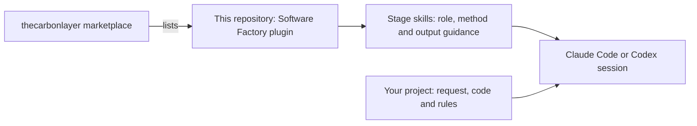
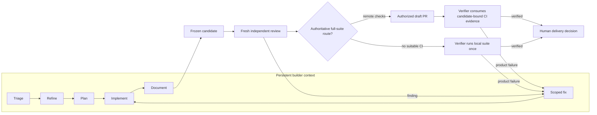

# Software Factory

Software Factory is a reusable set of stage skills for taking software work from an unclear request to a reviewed change. It gives each step a clear purpose: understand what is needed, agree on the behavior, plan the change, implement it and check the result.

The goal is to use these pieces on real work, observe where they fall short and improve them iteratively. Start with one issue and the stage it needs. You do not need to adopt a new development platform or run every stage for every change.

## What lives here

This repository is the **Software Factory plugin**. It is listed in the [thecarbonlayer marketplace](https://github.com/thecarbonlayer/plugin-marketplace), the catalog through which a host discovers installable plugins. The plugin contains ten capability skills, a submit skill and an orchestrator skill. Your own project is the **consumer**: it supplies the request, code, project rules and access to relevant discussion.

Software Factory is also a consumer of its own released plugin. Development of this repository uses the same Factory workflow described here. The installed stable release operates the task, while edited skills remain a candidate until they pass independent review, local behavioral qualification when applicable and deterministic PR verification. See [Developing Software Factory with Software Factory](docs/self-hosting.md).



A **capability** is a reusable method, such as refinement or security review. The main builder loads capabilities progressively while it keeps the task's evolving context. Independent review and verification run in fresh contexts and declare `Stage state: pending` or `Stage state: complete`. The same skills run in Claude Code and Codex. There are no agent definitions to install or copy. Models inherit the environment's choice.

The host runs the stages and enforces permissions. This plugin supplies the working methods, an explicitly triggered orchestration skill and a submit skill that opens a draft pull request when the person (or the consumer's own instructions) allows it; it does not start jobs on its own, watch issue replies, merge or deploy changes.

## Follow one request

Suppose a user reports: “Saving my notification preference does not stick.” Triage first checks the discussion and current code: is this still a bug, what evidence exists, and what prevents the next step?

If the desired behavior is unclear, refinement asks only the questions that matter—for example, whether the preference should apply across devices. It drafts **one comment containing the necessary questions**. A person or separately authorized host workflow can post it. When replies arrive, you supply them to a resumed refinement session, which produces requirements and acceptance criteria without guessing unanswered decisions.

Planning turns those agreed requirements into a scoped technical approach. Once the edit is authorized, implementation makes the change and checks its observable behavior. Review compares the final changed version with the acceptance criteria and identifies defects or remaining verification gaps.



The arrows describe stage handoffs: you can control them individually or use the `factory` skill below to sequence them. Stop the review-and-fix loop after two fix rounds: if findings remain, a person decides whether to accept, re-scope or continue. A blocked stage returns its specific gap. Existing authorization remains valid; the human gate is a decision boundary, not a mandatory repeated approval prompt. Larger or riskier plans need an approach review before implementation. Merge, publication and deployment remain separately authorized actions outside this flow.

For a small fix, refinement may need no questions and planning may be a few sentences. A large feature may need an interactive developer conversation before asynchronous refinement can finish. Pass along existing decisions instead of making each stage rediscover them.

## What each stage needs and returns

All stages accept ordinary text, links and files. Include relevant discussion, current repository context and project rules. There is no required input schema.

| Stage | Question it answers | Useful input | Output to carry forward |
| --- | --- | --- | --- |
| **Triage** | Is this ready for the named next stage? | Request, discussion, current evidence and target stage | Readiness, cited rationale, missing information, decisions and dependencies |
| **Refine** | What should users experience? | Triaged request, code context and any replies | One clarification-comment draft, or structured requirements with acceptance criteria and open decisions |
| **Plan** | How should we make and verify the change? | Refined requirements, constraints and current code | Scoped technical approach, dependencies, risks and verification plan |
| **Implement** | Does the authorized change deliver that behavior? | Agreed criteria, appropriate plan and edit scope | Reviewable changes, check results and remaining risks |
| **Document** | Do the project's docs match the implemented change? | Requirements, decisions, final code and implementation evidence | Updated existing docs, files left unchanged, missing destinations |
| **Review** | Does this frozen code-and-docs candidate meet the agreement? | Requirements, final diff and evidence ledger | Independent findings, acceptance assessment and limits |
| **Verify** | Does the frozen candidate pass the consumer's required checks and journeys? | Candidate, plan, capabilities, consumer policy, remote results and test guidance | Candidate-bound black-box results, evidence IDs and verification gaps |
| **Submit** | May this reviewed candidate be published as a draft, including to trigger remote verification? | Reviewed branch, current evidence and publication authority from the person or consumer policy | Pushed branch, draft PR link and pending verification state |

Triage defaults to assessing readiness for **pilot implementation** when no stage is specified. Name another stage when that is the decision you need. A failed investigation is reported separately from a request that is not ready.

Triage names missing decisions; refinement owns the questions, so users are asked once. Refinement starts from triage's evidence, asks through one [clarification comment](skills/refine/references/clarification-comment.md) with concrete examples and proposed answers, and separates factual code evidence from desired behavior. Its [requirements template](skills/refine/references/refinement-comment.md) covers scope, constraints, success criteria, completion measurement, appropriate checks and unresolved decisions.

Implementation uses proportionate **red-green-refactor** checks: demonstrate the behavioral failure, make it pass, then improve the changed code while preserving behavior. Tests should exercise workflows or observable contracts rather than mirror private implementation details. Documentation joins the code before the candidate is frozen. One fresh reviewer loads acceptance and code lenses, plus security and UX lenses when applicable. It may run targeted checks to prove findings. The verifier owns the conclusion for the complete consumer-required suite and declared role or persona journeys, but configured remote checks may own execution. The same expensive matrix does not run locally and remotely on one commit without a consumer-policy reason.

## Keep consumer context current

Before the candidate is frozen, the documentation stage [reconciles existing durable context](skills/document/references/durable-context.md) from the request, agreed requirements, decisions and implementation evidence. It finds the project's documentation without assuming a layout and prepares the updates in the task worktree. The independent reviewer then checks the code and documentation together:

| Existing consumer file | Update |
| --- | --- |
| README or product guide | Resulting behavior, usage and limitations |
| Root DECISIONS.md or existing decision records | Supported decisions and rationale, with agreement/authority evidence and preserved history |
| Tracked TASK_LOG.md or existing equivalent | Branch implementation evidence, known limits and the actual pending review, verification and delivery status |
| AGENTS.md | A concise context index saying when to read relevant files, plus actual setup prerequisites, check commands/scripts and locations, manual checks and execution limits, or links to that guidance |
| REVIEW.md | Review and verification policy, with links to canonical test guides and required role or persona matrices |

These are recommended destinations, not mandatory new files. Reuse the consumer's existing equivalents and formats. Report absent destinations or blocked edits without creating files by default. Preserve existing instructions; AGENTS.md is canonical and an existing CLAUDE.md uses a one-line `@AGENTS.md` include once unique instructions are safely preserved within scope. Keep both concise and within 200 lines. Use relative Markdown context links instead of eager imports of every document.

Unresolved decision proposals stay in task artifacts. Reconciliation records only decisions already agreed or made within delegated authority; it does not turn a plan recommendation into permission to reverse policy. The issue holds the original discussion and clarified requirements; the PR holds the shared delivery record. Ad hoc work puts necessary intent and accepted scope in the PR. Local `intent.md`, `spec.md`, `plan.md`, stage drafts and review iterations remain in the excluded `.factory/<task-id>/`. Do not commit a second per-task record to the consumer repository. Requirements, decisions and findings keep stable `R-001`, `D-001` and `F-001` IDs. Decision authority distinguishes user agreement, delegated implementation choices and unresolved proposals. A completed run may still await review or delivery; the tracked task log must not imply a merge or deployment that did not happen.

Refinement traces each material original request/spec item to an agreed criterion, a sourced scope change or an unresolved gap. Planning, implementation and review receive that trace and the original sources. Acceptance review checks both the original request/spec and the refined agreed criteria on the final code and documentation, distinguishing agreed changes from unmet or unverified items.

## Install in your host

Add the [thecarbonlayer marketplace](https://github.com/thecarbonlayer/plugin-marketplace), then install the plugin from it.

### Claude Code

```text
/plugin marketplace add thecarbonlayer/plugin-marketplace
/plugin install software-factory@thecarbonlayer
```

Check that the `software-factory:` skills appear, for example `/software-factory:factory`.

### Codex

```bash
codex plugin marketplace add thecarbonlayer/plugin-marketplace
codex plugin add software-factory@thecarbonlayer
codex plugin list --json
```

This installs the skills; nothing else is needed. 

## Run the stages automatically

The `factory` skill runs the whole sequence from the main session, which owns stage dispatch and task state. In Claude Code:

```text
/software-factory:factory start <issue link, number or request>
/software-factory:factory continue [task id] [answers or decisions]
/software-factory:factory status [task id]
/software-factory:factory submit [task id]
```

In Codex, mention `$software-factory:factory` with the same commands, for example `$software-factory:factory start <issue>`.

For a new task, it fetches the intended remote target and creates a separate `factory/<task id>` worktree directly from that revision before the first stage. It reports local commits outside the target and leaves the source checkout unchanged. A failed refresh or a request to include unpublished local commits needs a specific decision. Resume and submission compare the recorded target and task boundaries; target drift does not authorize an automatic rebase.

The first preflight records runner, skill, permission, timeout and environment capabilities in `capabilities.json`. Planning owns the exact verification commands and probes only newly required capabilities. An unchanged launch or permission failure is recorded once and is not retried until the environment changes.

Triage, refinement, planning, implementation, documentation and scoped fixes stay in one persistent builder context. Skills are loaded as the work needs them, so decisions and failed approaches do not have to be reconstructed at every boundary. A frozen candidate then goes to one fresh independent reviewer and one fresh verifier. The verifier consumes configured remote checks for the candidate head or a proven integration revision containing it, or runs the documented local suite once when no suitable remote route exists. The [factory skill](skills/factory/SKILL.md#context-model) defines when an extra context is justified.

The excluded `.factory/<task id>/` holds intent, accepted requirements, the plan, a capability snapshot, an append-only evidence ledger and immutable independent reports. `plan.md` owns complete rerun commands. `evidence.md` records each observed result once with a stable E ID. Fix reports carry only changed findings, commits and new evidence. The final summary preserves requirement coverage, verification gaps and sign-off evidence.

`start` preserves existing tasks and reserves a new identity before writing artifacts. It authorizes implementation within the plan's scope. Independent checks can run in parallel only when their resources are isolated; otherwise they are serialized. `continue` compares saved branch, commit, worktree, capabilities, remote-check identity and check environment before resuming. It preserves unexpected changes and marks affected results stale.

When configured remote checks own the full suite, the factory uses existing publication authority or asks for it after independent review, then publishes a draft and resumes verification from required jobs bound to the candidate head or a proven integration revision. Without suitable CI, it runs the documented local suite once before asking to submit when no publication authority already exists. It fixes within two rounds, has already reconciled durable documentation, and stops for unresolved decisions or verification gaps. It never marks ready, merges or deploys. A later merge-queue run on a changed combined tree is new integration evidence, not a duplicate candidate-tree run.

No CI is a supported repository shape. Factory falls back to consumer-documented local automation, then meaningful manual checks. If neither exists, it reports the affected behavior as unverified and asks for the delivery-risk decision. It does not create CI or a test framework implicitly.

Parallel worktrees isolate tasks but do not stop the delivery target from moving. Factory refreshes the target at candidate freeze, draft publication and final delivery. Conflict-free independent work can use the consumer's merge queue or equivalent integration check. Semantic overlap, source conflicts and task dependencies trigger an authorized branch update, stacked-PR convention or serialization. Factory never silently rebases another task.

## Try a stage, then hand off

Start in your consumer project with one request. Name the stage skill at the start of the prompt: `/software-factory:triage` in Claude Code, `$software-factory:triage` in Codex.

> /software-factory:triage Assess this issue for pilot implementation. Check current code and the latest discussion. Return readiness, evidence and gaps here.

To keep the stage's context separate from your session, run it as its own call, for example `claude -p "/software-factory:triage …"` or `codex exec -s read-only "$software-factory:triage …"`.

For a clarification round, use `refine`:

> Refine this triaged request. Batch only necessary unanswered questions into one proposed GitHub comment. Return the draft here.

After collecting replies:

> Resume refinement with this earlier draft and these replies. Produce the structured refinement comment; keep unanswered decisions visible.

Use the matching skill for the remaining handoffs:

- **Planning (`plan`):** “Plan the smallest sound change for these agreed requirements. Include scoped changes, risks and verification.”
- **Implementation (`implement`):** “Implement this agreed plan within the following authorized edit scope. Verify the acceptance criteria and report the actual check results.”
- **Documentation (`document`):** “Update this project's existing documentation for this implemented change before candidate freeze. Report files updated, files left unchanged and missing destinations.”
- **Review (`review`):** “Independently review this frozen candidate. Load code review and the applicable security and UX lenses. Report actionable findings and distinguish evidence from unrun checks.”
- **Verification (`verify`):** “Verify this frozen candidate from configured remote checks bound to its head or proven integration revision, or run the documented complete local suite once when no suitable remote route exists. Record the matrix, environment and limits.”

Advisory stages draft comments for the caller. Posting them, changing tracker state or sending messages requires authorization and host delivery capabilities.

## Find the reusable pieces

Skills use the `software-factory:` namespace:

| Stage | Skills |
| --- | --- |
| Triage | [triage](skills/triage/SKILL.md) |
| Refinement | [refine](skills/refine/SKILL.md) |
| Planning | [plan](skills/plan/SKILL.md) |
| Implementation | [implement](skills/implement/SKILL.md) |
| Documentation | [document](skills/document/SKILL.md) |
| Independent review | [review](skills/review/SKILL.md) + [review-code](skills/review-code/SKILL.md) |
| Security review | review + [review-security](skills/review-security/SKILL.md) |
| UX review | review + [review-ux](skills/review-ux/SKILL.md) |
| Independent verification | [verify](skills/verify/SKILL.md) |
| Main session only | [submit](skills/submit/SKILL.md), [factory](skills/factory/SKILL.md) |


```text
plugin.json                          Portable metadata
.claude-plugin/plugin.json           Claude metadata
skills/*/SKILL.md                    Capability skills: role, method and output
skills/refine/
  references/clarification-comment.md  Refinement question format
  references/refinement-comment.md   Refinement output template
skills/factory/                      Orchestration skill (start, continue, status, submit)
  references/task-folder.md          Task folder layout and state format
evals/                               Generic behavioral scenarios and scoring rubric
```

The repository root is the plugin; the marketplace catalogs live in [thecarbonlayer/plugin-marketplace](https://github.com/thecarbonlayer/plugin-marketplace). Contributor guidance and authoring references live in [AGENTS.md](AGENTS.md); [CLAUDE.md](CLAUDE.md) imports that same guidance. Repository-specific review and verification policy lives in [REVIEW.md](REVIEW.md).


## Develop the Factory with the Factory

For non-trivial changes to this repository, start with the installed `software-factory:factory` skill. It creates the same isolated task worktree and evidence boundary used for any consumer repository. `.factory/` is ignored so intent, plans, raw reports and local evaluation transcripts cannot enter a commit.

The running task keeps its installed release. Candidate skills are loaded only by fresh sessions that are explicitly evaluating them. The deterministic `PR quality` job validates the submitted revision; behavioral evals run locally on a trusted machine when shipped skill behavior changes. Starting an authorized Factory task here includes authority to commit, push and open or update its draft after independent review, while ready state, approval, merge and deployment remain separately authorized. The complete lifecycle is in the [self-hosting guide](docs/self-hosting.md).


## Qualify the plugin

This repository contains instructions and packaging, not a runnable consumer product. Pull requests run the authoritative complete deterministic suite in [PR quality](.github/workflows/pr-quality.yml). The workflow does not call a model or require model credentials.

During implementation, run the focused checks needed for the affected behavior. Once an authorized draft exists, let PR quality own the complete deterministic matrix rather than repeating it locally on the same candidate. To reproduce or diagnose that matrix locally, replace `origin/main` when the pull request targets another revision:

```bash
python3 -m unittest discover -s tests
python3 scripts/validate_repository.py --base-ref origin/main
git diff --check origin/main...HEAD
```

The repository validator checks JSON parsing, synchronized manifests, Agent Skills metadata, native skill references, relative Markdown links, version increases for plugin changes and accidental local workstation paths. It uses only the Python standard library.

With Claude Code on PATH, also validate the plugin package:

```bash
claude plugin validate .
```

Plugin validation can pass with metadata warnings. Read the exit status and warnings; validation does not prove native stage execution or behavioral quality.

When shipped skill behavior changes, run the tracked [generic eval suite](evals/README.md) locally on a trusted machine with configured coding agents. Compare the previous release and candidate, then qualify on a de-identified frozen consumer trace and a structurally different consumer or synthetic repository. Keep transcripts, credentials and consumer data local and commit only aggregate results. Documentation or infrastructure-only changes may skip behavioral execution when they record why shipped skill behavior is unchanged.

## Standards and authoring practices

We use the [Agent Plugins standard](https://agent-plugins.org/specification) for portable packaging and the [Agent Skills specification](https://agentskills.io/specification) and authoring practices for shared methods. This package ships only skills, the portable core. Stage dispatch uses each host's documented non-interactive CLI ([Claude Code](https://code.claude.com/docs/en/headless), [Codex](https://learn.chatgpt.com/docs/non-interactive-mode)) and generic subagents ([Claude Code](https://code.claude.com/docs/en/sub-agents), [Codex](https://learn.chatgpt.com/docs/agent-configuration/subagents)) as the fallback. Format compliance alone does not establish runtime compatibility.

We follow the official instruction guidance from [OpenAI](https://developers.openai.com/codex/guides/agents-md) and [Anthropic](https://code.claude.com/docs/en/memory): open each skill with role and judgment, then give the procedure, load supporting detail when needed and keep checks proportional to the work. These choices make the baseline easier to use and revise as real tasks reveal what needs improvement.
