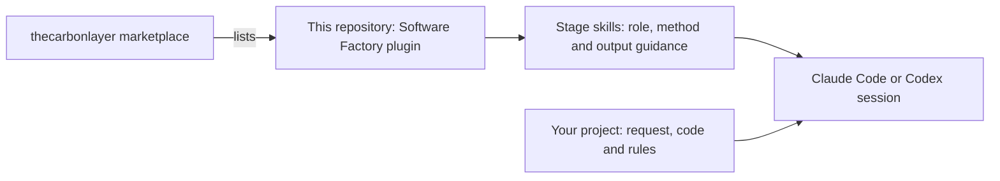
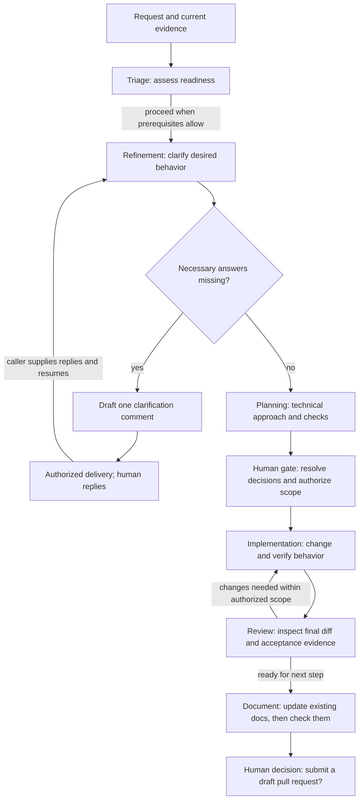

# Software Factory

Software Factory is a reusable set of stage skills for taking software work from an unclear request to a reviewed change. It gives each step a clear purpose: understand what is needed, agree on the behavior, plan the change, implement it and check the result.

The goal is to use these pieces on real work, observe where they fall short and improve them iteratively. Start with one issue and the stage it needs. You do not need to adopt a new development platform or run every stage for every change.

## What lives here

This repository is the **Software Factory plugin**. It is listed in the [thecarbonlayer marketplace](https://github.com/thecarbonlayer/plugins), the catalog through which a host discovers installable plugins. The plugin contains nine stage skills, a submit skill and an orchestrator skill. Your own project is the **consumer**: it supplies the request, code, project rules and access to relevant discussion.



A **stage** is a step in the flow, such as triage or review. Each stage loads a **skill**: its role and boundaries, then the reusable procedure and output guidance. A focused review loads two. The same skills run in Claude Code and Codex. There are no agent definitions to install or copy. Models inherit the environment's choice.

The host runs the stages and enforces permissions. This plugin supplies the working methods, an explicitly triggered orchestration skill and a submit skill that opens a draft pull request when the person (or the consumer's own instructions) allows it; it does not start jobs on its own, watch issue replies, merge or deploy changes.

## Follow one request

Suppose a user reports: “Saving my notification preference does not stick.” Triage first checks the discussion and current code: is this still a bug, what evidence exists, and what prevents the next step?

If the desired behavior is unclear, refinement asks only the questions that matter—for example, whether the preference should apply across devices. It drafts **one comment containing the necessary questions**. A person or separately authorized host workflow can post it. When replies arrive, you supply them to a resumed refinement session, which produces requirements and acceptance criteria without guessing unanswered decisions.

Planning turns those agreed requirements into a scoped technical approach. Once the edit is authorized, implementation makes the change and checks its observable behavior. Review compares the final changed version with the acceptance criteria and identifies defects or remaining verification gaps.



The arrows describe stage handoffs: you can control them individually or use the `factory` skill below to sequence them. Stop the review-and-fix loop after two fix rounds: if findings remain, a person decides whether to accept, re-scope or continue. A blocked stage returns its specific gap. Existing authorization remains valid; the human gate is a decision boundary, not a mandatory repeated approval prompt. Larger or riskier plans need an approach review before implementation. Merge, publication and deployment remain separately authorized actions outside this flow.

For a small fix, refinement may need no questions and planning may be a few sentences. A large feature may need an interactive developer conversation before asynchronous refinement can finish. Pass along existing decisions instead of making each stage rediscover them.

## What each stage needs and returns

All stages accept ordinary text, links and files. Include relevant discussion, current repository context and project rules. There is no required input schema.

| Stage | Question it answers | Useful input | Output to carry forward |
| --- | --- | --- | --- |
| **Triage** | Is this ready for the named next stage? | Request, discussion, current evidence and target stage | Readiness, cited rationale, missing information, decisions and dependencies |
| **Refinement** | What should users experience? | Triaged request, code context and any replies | One clarification-comment draft, or structured requirements with acceptance criteria and open decisions |
| **Planning** | How should we make and verify the change? | Refined requirements, constraints and current code | Scoped technical approach, dependencies, risks and verification plan |
| **Implementation** | Does the authorized change deliver that behavior? | Agreed criteria, appropriate plan and edit scope | Reviewable changes, check results and remaining risks |
| **Review** | Does this final version meet the agreement? | Requirements, final diff and verification evidence | Actionable findings, acceptance assessment and limits |
| **Document** | Do the project's docs match the reviewed change? | Requirements, decisions, final code and review results | Updated existing docs, files left unchanged, missing destinations |
| **Submit** | Is the branch ready for people to review as a pull request? | Finished, reviewed branch and summary; the person's approval | Pushed branch and a draft pull request link |

Triage defaults to assessing readiness for **pilot implementation** when no stage is specified. Name another stage when that is the decision you need. A failed investigation is reported separately from a request that is not ready.

Triage names missing decisions; refinement owns the questions, so users are asked once. Refinement starts from triage's evidence, asks through one [clarification comment](skills/refine/references/clarification-comment.md) with concrete examples and proposed answers, and separates factual code evidence from desired behavior. Its [requirements template](skills/refine/references/refinement-comment.md) covers scope, constraints, success criteria, completion measurement, appropriate checks and unresolved decisions.

Implementation uses proportionate **red-green-refactor** checks: demonstrate the behavioral failure, make it pass, then improve the changed code while preserving behavior. Tests should exercise workflows or observable contracts rather than mirror private implementation details. Review distinguishes passed, failed and unrun checks, and ties its conclusion to the final version it actually inspected. Besides acceptance review, three focused reviews can run on the same version: security, UX (runs the app as each role) and code. Each loads the `review` skill plus its focus skill (`review-security`, `review-ux`, `review-code`); the caller combines their findings.

## Keep consumer context current

After the last code review, the documentation stage [reconciles existing durable context](skills/document/references/durable-context.md) from the request, agreed requirements, decisions, implementation, verification and review results. It finds the project's documentation without assuming a layout, prepares the updates in the task worktree, and the acceptance reviewer checks the documentation diff:

| Existing consumer file | Update |
| --- | --- |
| README or product guide | Resulting behavior, usage and limitations |
| Root DECISIONS.md or existing decision records | Supported decisions and rationale, with agreement/authority evidence and preserved history |
| Tracked TASK_LOG.md or existing equivalent | Completed work, verification, limitations and actual branch/delivery status |
| AGENTS.md | A concise context index saying when to read relevant files, plus actual setup prerequisites, check commands/scripts and locations, manual checks and execution limits, or links to that guidance |

These are recommended destinations, not mandatory new files. Reuse the consumer's existing equivalents and formats. Report absent destinations or blocked edits without creating files by default. Preserve existing instructions; AGENTS.md is canonical and an existing CLAUDE.md uses a one-line `@AGENTS.md` include once unique instructions are safely preserved within scope. Keep both concise and within 200 lines. Use relative Markdown context links instead of eager imports of every document.

Unresolved decision proposals stay in task artifacts. Reconciliation records only decisions already agreed or made within delegated authority; it does not turn a plan recommendation into permission to reverse policy. Detailed stage drafts and review iterations remain in the locally excluded `.factory/<task-id>/`. A completed run may still await review or delivery; the tracked task log must not imply a merge or deployment that did not happen.

Refinement traces each material original request/spec item to an agreed criterion, a sourced scope change or an unresolved gap. Planning, implementation and review receive that trace and the original sources. Acceptance review checks both the original request/spec and the refined agreed criteria on the final code and documentation, distinguishing agreed changes from unmet or unverified items.

## Install in your host

Add the [thecarbonlayer marketplace](https://github.com/thecarbonlayer/plugins), then install the plugin from it.

### Claude Code

```text
/plugin marketplace add thecarbonlayer/plugins
/plugin install software-factory@thecarbonlayer
```

Check that the `software-factory:` skills appear, for example `/software-factory:factory`.

### Codex

```bash
codex plugin marketplace add thecarbonlayer/plugins
codex plugin add software-factory@thecarbonlayer
codex plugin list --json
```

This installs the skills; nothing else is needed. Releases before 0.7.0 asked you to copy `.codex/agents/*.toml` files into each consumer project. Those copies are no longer used and can be deleted.

Keep the plugin enabled for the user, so the stages the factory starts find the skills by name.

If you installed the early `software-factory-triage` identity, remove that old entry through your host's normal controls before installing `software-factory`.

## Run the stages automatically

The `factory` skill runs the whole sequence from the main session, which owns stage dispatch and task state. In Claude Code:

```text
/software-factory:factory start <issue link, number or request>
/software-factory:factory continue [task id] [answers or decisions]
/software-factory:factory status [task id]
/software-factory:factory submit [task id]
```

In Codex, mention `$software-factory:factory` with the same commands, for example `$software-factory:factory start <issue>`.

It keeps one markdown file per stage in `.factory/<task id>/` (excluded locally through `.git/info/exclude`, so the main checkout stays clean), implements in a separate worktree on a `factory/<task id>` branch, picks focused reviewers by what changed, fixes what it can within two rounds, updates the project's documentation once after the last code review, and stops only for refinement questions, open risky-area items and final sign-off. At sign-off it asks whether to submit: push the branch and open a draft pull request. It pushes only with that yes, `submit`, or the consumer's own opt-in to automatic draft pull requests, and it never merges. Running `start` authorizes implementation within the scope of the plan it produces.

Each stage runs separately and loads its skill by name. The preferred way is one CLI call per stage (`claude -p` in Claude Code, `codex exec` in Codex) with a permission profile for that stage: read-only, checks or edit. When the CLI is not available, the factory starts a generic subagent with the same prompt instead. The [factory skill](skills/factory/SKILL.md#running-a-stage) has the exact commands.

`start` preserves existing tasks and reserves a new identity before writing artifacts. Every changed candidate gets acceptance and code review plus applicable focused reviews; independent checks can run in parallel, while checks sharing mutable resources are isolated or serialized. `continue` compares the saved branch, commit and worktree evidence with the actual checkout before resuming, preserving unexpected changes and reporting stale results. These rules are skill instructions; the agent harness and project tools perform the checks.

## Try a stage, then hand off

Start in your consumer project with one request. Name the stage skill at the start of the prompt: `/software-factory:triage` in Claude Code, `$software-factory:triage` in Codex.

> /software-factory:triage Assess this issue for pilot implementation. Check current code and the latest discussion. Return readiness, evidence and gaps here.

To keep the stage's context separate from your session, run it as its own call, for example `claude -p "/software-factory:triage …"` or `codex exec -s read-only "$software-factory:triage …"`.

For a clarification round, use `refine`:

> Refine this triaged request. Batch only necessary unanswered questions into one proposed GitHub comment. Return the draft here.

After collecting replies:

> Resume refinement with this earlier draft and these replies. Produce the structured refinement comment; keep unanswered decisions visible.

Use the matching skill for the remaining handoffs:

- **Planning (`plan`):** “Plan the smallest sound change for these agreed requirements. Include scoped changes, risks and verification.”
- **Implementation (`implement`):** “Implement this agreed plan within the following authorized edit scope. Verify the acceptance criteria and report the actual check results.”
- **Review (`review`):** “Review this final diff against these acceptance criteria. Report actionable findings and distinguish verified behavior from unrun checks.”
- **Documentation (`document`):** “Update this project's existing documentation for this reviewed change. Report files updated, files left unchanged and missing destinations.”
- **Focused review:** run `review` together with `review-security`, `review-ux` or `review-code` on the same version with the same input, then combine their findings.

Advisory stages draft comments for the caller. Posting them, changing tracker state or sending messages requires authorization and host delivery capabilities.

## Find the reusable pieces

Skills use the `software-factory:` namespace:

| Stage | Skills |
| --- | --- |
| Triage | [triage](skills/triage/SKILL.md) |
| Refinement | [refine](skills/refine/SKILL.md) |
| Planning | [plan](skills/plan/SKILL.md) |
| Implementation | [implement](skills/implement/SKILL.md) |
| Documentation | [document](skills/document/SKILL.md) |
| Acceptance review | [review](skills/review/SKILL.md) |
| Security review | review + [review-security](skills/review-security/SKILL.md) |
| UX review | review + [review-ux](skills/review-ux/SKILL.md) |
| Code review | review + [review-code](skills/review-code/SKILL.md) |
| Main session only | [submit](skills/submit/SKILL.md), [factory](skills/factory/SKILL.md) |

### Renamed stages

Older releases used longer names. Releases 0.6.0 and earlier also had named agents (the last column); 0.7.0 removed them. Update consumer notes that name them, and delete copied `.codex/agents/*.toml` files.

| Old skill | New skill | Old agent | 0.6.0 agent (removed in 0.7.0) |
| --- | --- | --- | --- |
| triage-readiness | triage | triage | triager |
| requirements-refinement | refine | refinement | refiner |
| implementation-planning | plan | planning | planner |
| behavior-driven-implementation | implement | implementation | implementer |
| acceptance-review | review | review | reviewer |
| code-review | review-code | code-review | code-reviewer |
| security-review | review-security | security-review | security-reviewer |
| ux-review | review-ux | ux-review | ux-reviewer |
| (new) | document | (new) | documenter |
| (new) | submit | | |

```text
plugin.json                          Portable metadata
.claude-plugin/plugin.json           Claude metadata
skills/*/SKILL.md                    Stage skills: role, method and output
skills/refine/
  references/clarification-comment.md  Refinement question format
  references/refinement-comment.md   Refinement output template
skills/factory/                      Orchestration skill (start, continue, status, submit)
  references/task-folder.md          Task folder layout and state format
```

The repository root is the plugin; the marketplace catalogs live in [thecarbonlayer/plugins](https://github.com/thecarbonlayer/plugins). Contributor guidance and authoring references live in [AGENTS.md](AGENTS.md); [CLAUDE.md](CLAUDE.md) imports that same guidance.

## Current baseline

Version **0.2.0** has passed basic metadata, catalog, definition, skill-reference and link checks, plus isolated installation and exposure of all five skills in Codex 0.159.0-alpha.3. Behavioral evaluation is deferred: the earlier Codex pilot encountered a model-endpoint proxy 403, and Claude Code was unavailable. Native execution and desktop integration are not yet verified. The next learning step is to use the stages on real work and improve what fails.

Version **0.3.0** adds the three focused reviewers and changes from replaying one real, already-shipped issue through triage, refinement and planning, scored against what actually shipped. Each change was checked with one run per version, mostly through general-purpose subagents given the skill text, so these are likely improvements, not proof. Commit messages record each check and its limits.

Version **0.4.0** adds the `factory` orchestration skill. It was developed with two test iterations on a small fixture repository (clear request, vague request, resume in a new session); one run per test, so treat the results as early evidence.

Version **0.5.0** adds reconciliation of existing consumer context files, traces the original request through refinement and final review, and protects task progress across repeated starts, fix reviews, shared test resources and resume. It also permits bounded error recovery, verifies doubtful handoff evidence, uses normal UX entry points, and follows the project's migration recovery policy while retaining read-only triage and main-session orchestration.

Validation covers plugin/marketplace metadata, skill format, JSON/TOML syntax, references and whitespace. Isolated filesystem/Git checks exercised atomic task reservation, preservation of task artifacts and detection of branch/commit/file changes. Independent scenarios exercised context reconciliation, final-review selection, shared-resource scheduling, resume, recovery and the wording changes. These are limited checks and scenarios, not native end-to-end validation of 0.5.0 or evidence of improved model performance.

Version **0.6.0** renames the stages: skills are verbs (`triage`, `refine`, `plan`, `implement`, `review`) and agents are roles (`triager`, `refiner`, `planner`, `implementer`, `reviewer`); see [Renamed stages](#renamed-stages). A `documenter` agent now updates the project's existing documentation once, after the last code review, and the reviewer checks that diff. A `submit` skill pushes the task branch and opens a draft pull request when the person approves it, or when the consumer's own instructions opt in; it never merges. Task artifacts are shorter: one review file per round with a merged findings table, and `state.md` and `summary.md` open with what the person must decide. It was shaped by reviewing one real run on a consumer project. Checks cover plugin and marketplace validation, JSON/TOML syntax, relative links and whitespace; the new and renamed stages have not yet run on a real task.

Version **0.7.0** removes the named agent definitions (`agents/*.md` and `.codex/agents/*.toml`). Each stage skill now opens with the role and boundaries those agents held. The factory runs each stage as its own `claude -p` or `codex exec` call with a read-only, checks or edit permission profile, and falls back to a generic subagent when the CLI is not available. One plugin now works the same in both hosts, and Codex consumers no longer copy agent files. Evidence: before the change, a headless `codex exec -s read-only` run (codex-cli 0.162.0-alpha.17.2) loaded the installed `triage` skill by `$software-factory:triage` mention and returned a correct assessment of a real consumer issue without agent files. The matching Claude Code run did not reach the model because the CLI login had expired. A full factory run with CLI dispatch has not run in either host.

## Qualify the plugin

This repository contains instructions and packaging, not a runnable consumer product. From the repository root, with Claude Code on PATH, validate the plugin:

```bash
claude plugin validate .
```

Both commands can pass with metadata warnings. Read the exit status and warnings; validation does not prove native stage execution or behavioral quality. For a syntax smoke check:

```bash
python3 - <<'PY'
import json
from pathlib import Path
for path in Path('.').rglob('*.json'):
    json.loads(path.read_text())
print('JSON parsed')
PY
git diff --check
```

Manually check changed skill links and native skill references. Use the host installation steps above for loading checks, and exercise changed guidance on a scoped real task or isolated scenario for behavioral evidence. For context reconciliation, inspect the documentation diff and task-log delivery status as well as code; review any dropped original requirement explicitly. Keep drafts and evaluation artifacts local. Record which agent harness, version and checks were used, and distinguish a simulation or supplied skill text from native plugin execution. [Current baseline](#current-baseline) lists the known runtime limits.

## Standards and authoring practices

We use the [Agent Plugins standard](https://agent-plugins.org/specification) for portable packaging and the [Agent Skills specification](https://agentskills.io/specification) and authoring practices for shared methods. This package ships only skills, the portable core. Stage dispatch uses each host's documented non-interactive CLI ([Claude Code](https://code.claude.com/docs/en/headless), [Codex](https://learn.chatgpt.com/docs/non-interactive-mode)) and generic subagents ([Claude Code](https://code.claude.com/docs/en/sub-agents), [Codex](https://learn.chatgpt.com/docs/agent-configuration/subagents)) as the fallback. Format compliance alone does not establish runtime compatibility.

We follow the official instruction guidance from [OpenAI](https://developers.openai.com/codex/guides/agents-md) and [Anthropic](https://code.claude.com/docs/en/memory): open each skill with role and judgment, then give the procedure, load supporting detail when needed and keep checks proportional to the work. These choices make the baseline easier to use and revise as real tasks reveal what needs improvement.
